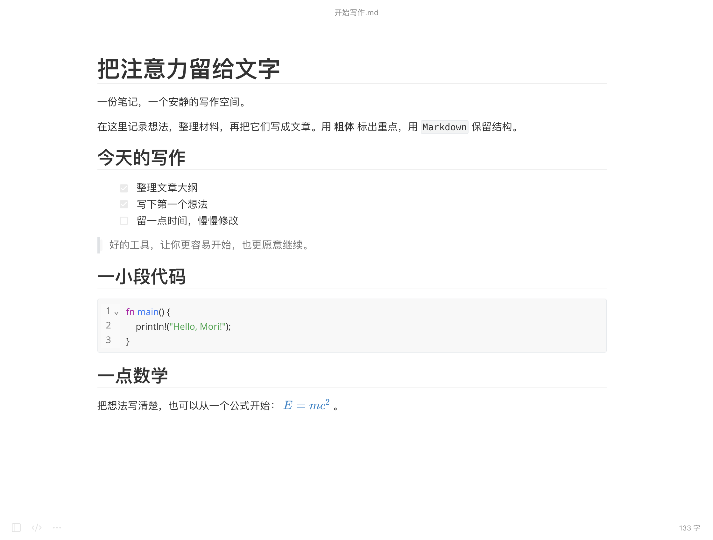
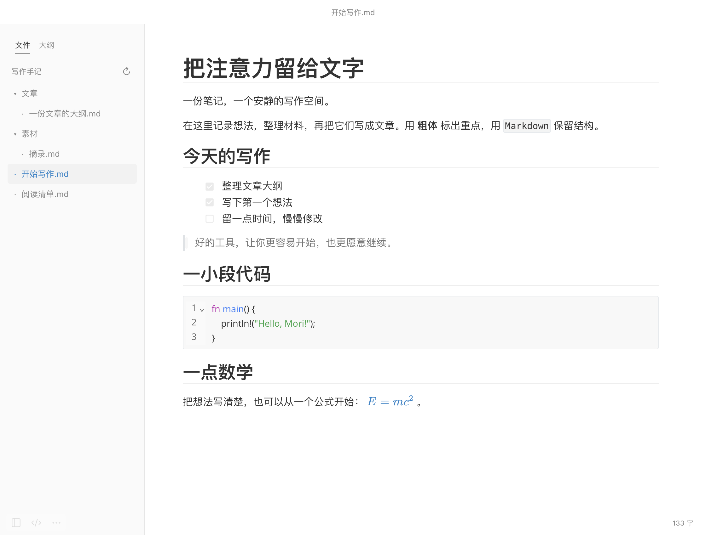
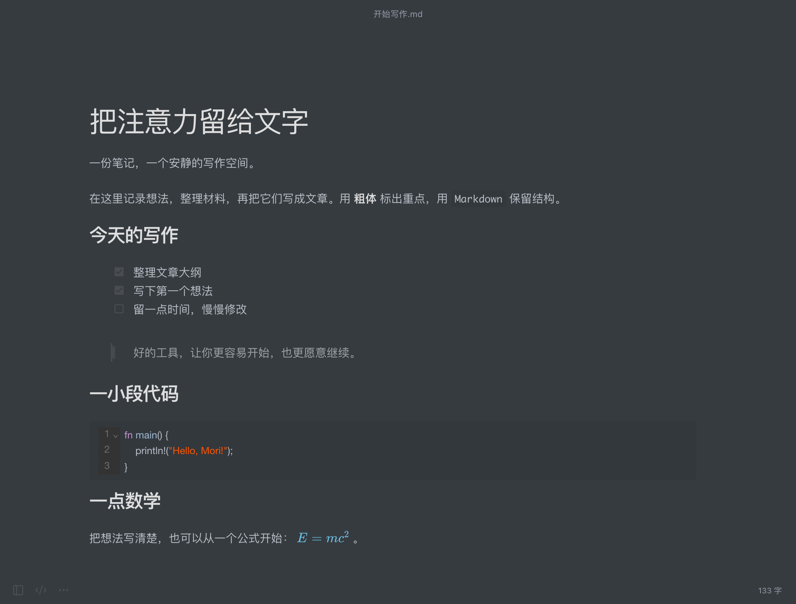
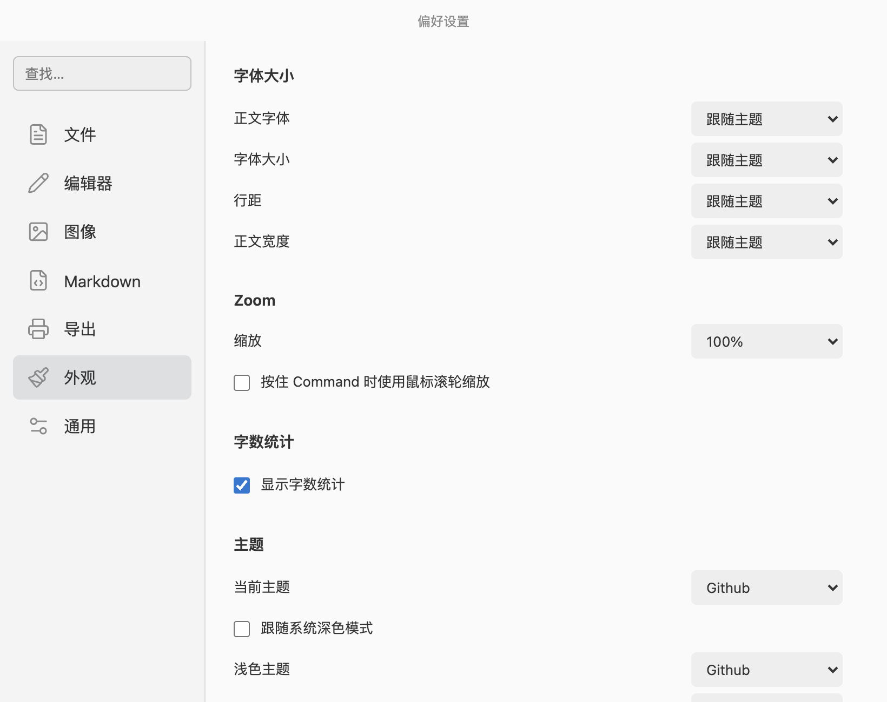

<p align="center">
  
</p>

<h1 align="center">Mori · 墨笺</h1>

<p align="center">把注意力留给文字。</p>
<p align="center">使用 Rust + Tauri 复刻 Typora 的核心写作体验</p>

Mori 使用 **Rust + Tauri** 复刻 Typora 的核心写作体验，专为 macOS 设计：打开就是一页空白，Markdown 格式就地呈现，需要时切换源码，文件与大纲按需展开。

Rust 负责文件读写、保存保护、目录访问和原生系统交互；编辑界面由 TypeScript、Milkdown / ProseMirror 与 CodeMirror 实现。我们复刻的是喜欢的写作体验，并独立编写应用逻辑。

## 为什么选择 Mori

Mori 的目标，是把日常写作需要的功能做成一款**简洁、可定制、带窗口遮蔽的 macOS 编辑器**。它的优势来自这些具体的选择：

| 优势 | 对使用者意味着什么 |
| --- | --- |
| **Rust 处理本地文件** | 文件读写、目录边界和保存校验集中在原生后端，使用原子替换与内容摘要保护已有文档。 |
| **复用 macOS 系统 WebView** | Tauri 使用系统提供的网页渲染组件，无需随应用分发完整浏览器运行时。 |
| **界面围绕写作收敛** | 默认没有欢迎文字、常驻格式工具栏或选字浮层，正文之外的文件树、大纲与设置按需打开。 |
| **窗口遮蔽直接内置** | 一键隐藏窗口内容，也可在闲置后自动遮蔽，无需另外安装隐私插件。 |
| **源码可以继续按需修改** | Rust 后端与编辑界面源码一起交付，可自行调整交互、扩展功能和重新构建，不局限于主题 CSS。 |
| **围绕个人工作流调整** | 文件夹浏览、即时编辑、主题、字号、保存与恢复集中在一个本地应用中，不依赖账号或云端文档服务。 |

如果你重视 macOS 本地写作、简洁界面、临时遮蔽和可修改的实现，这些取舍就是选择 Mori 的理由。启动速度和内存占用尚未与 Typora 做同机对比测试；这里不承诺未经验证的性能优势。功能覆盖范围见下方「当前边界」。

[下载最新版本](https://github.com/00lingxiao00/Mori/releases/latest) · [更新日志](CHANGELOG.md) · [参与开发](CONTRIBUTING.md)

当前版本 **0.1.0**，提供 **Apple Silicon（M 系列）** 构建，最低部署版本为 **macOS 12**。




[开始使用](#开始使用) · [功能](#功能) · [快捷键](#快捷键) · [开发与验证](#开发与验证)

## 开始使用

### 安装

1. 从 [Releases](https://github.com/00lingxiao00/Mori/releases/latest) 下载并解压 `Mori-macOS-arm64-0.1.0.zip`。
2. 将 `Mori.app` 拖入「应用程序」，然后打开。
3. 按 **⌘N** 新建，或按 **⌘O** 打开已有文档。

当前交付包使用本地临时签名，尚未经过 Apple 开发者签名与公证；首次打开可能被 macOS 拦截。确认文件来源后，可在「系统设置 → 隐私与安全性」中检查是否出现允许打开的选项。当前没有提供 Intel 构建或自动更新服务。

### 一分钟上手

- **直接写。** 输入 `# 标题`、`**粗体**` 或列表语法，格式会在正文中呈现；空行输入 `/` 可打开插入菜单。
- **查看源码。** 按 **⌘/** 在即时编辑与源码之间切换。
- **打开文件夹。** 按 **⇧⌘O**，从左侧文件树切换文档；侧边栏顶部可切换「文件」和「大纲」。
- **调整阅读感受。** 从「主题」菜单选择样式，从「显示 → 字号」调整文字大小；更多选项在 **⌘,**。
- **保存。** 按 **⌘S** 首次保存。已命名文档默认在停笔约 1.5 秒后自动保存。

左下角保留侧边栏、源码和菜单入口，右下角显示字数。窗口可自由调整大小，侧边栏与正文保持并排。

## 功能

| 写作需要 | Mori 提供的功能 |
| --- | --- |
| 日常 Markdown | 标题、粗体、斜体、删除线、引用、链接、列表、任务列表、水平线 |
| 技术与长文 | 代码高亮、表格及行列编辑、KaTeX 数学公式、可编辑脚注与往返跳转 |
| 本地资料整理 | 文件夹浏览、子目录展开、当前文件高亮、大纲导航与折叠 |
| 专心写作 | 专注模式、打字机模式、字数统计、查找与替换 |
| 个性化排版 | 8 个主题、系统浅深色切换、字体、字号、行距、正文宽度和缩放 |
| 输出与保存 | Markdown、基础样式 HTML、系统打印／PDF、自动保存、本地恢复草稿 |
| 临时隐藏内容 | 手动或闲置自动遮蔽窗口，可选择模糊或纯色 |

### 文件夹与大纲

通过「文件 → 打开文件夹…」或 **⇧⌘O** 打开一个文件夹。文件树按需加载子目录，显示 `.md`、`.markdown`、`.mdown` 和 `.txt` 文件；扩展名不区分大小写。隐藏条目与符号链接不列入文件树。



打开文件夹会保留当前文档。点击另一份文件前，Mori 会检查未保存内容；取消后仍留在原文档。不同文档的撤销记录相互隔离。点击文件夹名旁的刷新按钮可更新列表，桌面版回到窗口时也会刷新可见的文件树。

侧边栏顶部的「大纲」显示当前文档的标题，可点击跳转；在设置中启用折叠后，可收起某个标题下的子标题。**⇧⌘L** 用于显示／隐藏整个侧边栏。

当前以一个文档编辑窗口为中心，文件夹侧边栏用于逐份切换文档；尚未提供多文档标签页或文件树内的新建、重命名、移动与删除操作。

### 即时编辑与源码

即时编辑采用普通文字光标和鼠标选区，支持跨段落选择；不显示选区浮动工具栏和段落拖拽手柄。格式操作可通过快捷键、macOS 菜单栏或空行 `/` 插入菜单完成。

- **代码：** 支持语言高亮，可设置默认语言、缩进、行号和自动换行。
- **表格：** 支持对齐，以及插入／删除行列；相关菜单随光标位置启用。
- **公式：** 支持 `$…$` 行内公式与 `$$…$$` 公式块，公式块可切换编辑。
- **脚注：** 支持 `[^1]` 与 `[^1]: 内容`，正文按首次引用顺序编号，点击编号跳转到文末，点击返回符号回到正文。
- **内联 HTML：** 支持 `<kbd>`、`<mark>`、`<u>`；其它 HTML 保留为文字，不作为网页脚本执行。

源码模式使用 CodeMirror。仅查看文档、切换模式或调整排版设置，不会主动重写原始 Markdown；实际进行即时编辑后，保存内容会经过编辑器的 Markdown 序列化，空格、列表标记等格式可能变化。

### 主题与字号

内置 **Github、Gothic、Newsprint、Night、Pixyll、Whitey、Lapis、Lapis Dark** 八个主题。主题选择会记住，也可以在「设置 → 外观」中指定跟随系统的浅色／深色主题。



字号可在「显示 → 字号」或左下角菜单中调整，范围为 **12–36 px**，支持增大、减小和跟随主题。源码字号同步应用；界面缩放可在「显示」菜单独立调整。

在「设置 → 外观」中，还能调整正文字体、行距和正文宽度。

### 设置

按 **⌘,** 打开设置。选项实时应用并在重开后保留，支持搜索、JSON 导入／导出和恢复默认值。



| 分类 | 常用选项 |
| --- | --- |
| 文件 | 启动模式、默认扩展名、大纲折叠、自动保存延迟、恢复草稿 |
| 编辑器 | 括号与 Markdown 符号配对、拼写检查、复制 Markdown、打字机光标居中 |
| 图像 | 嵌入或复制到 `assets`、相对路径前缀、URL 转义 |
| Markdown | 标题、列表与强调语法偏好，代码语言／缩进／行号／换行 |
| 导出 | HTML 样式与标题、空格保留、打印纸张与页边距 |
| 外观 | 字体、字号、行距、正文宽度、主题、缩放与字数显示 |
| 通用 | 窗口遮蔽、设置导入／导出、恢复默认设置 |

### 窗口遮蔽

按 **⇧⌘P**，或选择「显示 → 遮蔽／显示窗口」，可遮蔽正文、大纲和设置窗口。手动遮蔽不会因鼠标移动而解除；按同一快捷键、**Esc** 或点击眼睛按钮恢复。

在「设置 → 通用 → 隐私」中可启用闲置自动遮蔽，默认等待时间为 30 秒，效果可选模糊或纯色。自动遮蔽后，移动鼠标或按键即可恢复；第一次唤醒操作不会输入正文。

遮蔽用于视觉隐藏，恢复无需身份验证；它不是密码锁或文件加密。

### 图片与导出

插入或粘贴图片默认嵌入为 data URL。对于已经保存的文档，可以改为复制到同目录的 `assets` 文件夹；相同图片按内容复用，避免重复存储。复制方式支持 PNG、JPEG、GIF 和 WebP，未命名文档沿用嵌入方式。

本地相对图片仅从当前文档目录及其子目录读取；远程图片 URL 会请求对应的图片服务器。

「文件 → 导出」支持 Markdown 与基础样式 HTML；PDF 通过 macOS 打印面板保存。导出不会改变当前编辑文档的保存路径。暂不支持 Word 或依赖 Pandoc 的导出流程。

## 保存与恢复

文档以 UTF-8 文本读写，不需要账号。文件读写、设置与恢复草稿均在本机完成。

- **自动保存：** 只对已命名文档生效，可在「文件」菜单或设置中关闭、调整延迟。
- **恢复草稿：** 未命名文档不会反复弹出保存面板，而是保留本地恢复草稿；下次启动可选择恢复或明确舍弃。恢复后的内容作为未命名文档打开。
- **离开前确认：** 新建、打开另一份文件、关闭和退出时检查未保存更改。
- **外部修改保护：** 保存前对比磁盘内容摘要。文件被其它程序修改、移动或删除后，会阻止覆盖并提示另存为。
- **原子保存：** 先写临时文件，再替换目标文件，减少失败写入破坏原文的风险。

设置与恢复草稿保存在：

```text
~/Library/Application Support/studio.mori.editor/
├── preferences.json
└── recovery.json
```

关闭恢复功能只停止后续草稿写入，不会主动删除未处理的恢复文件。取消恢复后，原有草稿也会保留。恢复草稿不代替独立备份或版本管理。

## 快捷键

`⌘` 表示 Command，`⇧` 表示 Shift，`⌥` 表示 Option。

| 快捷键 | 操作 |
| --- | --- |
| ⌘N / ⌘O | 新建／打开文档 |
| ⇧⌘O | 打开文件夹 |
| ⌘S / ⇧⌘S | 保存／另存为 |
| ⌘, | 打开设置 |
| ⌘/ | 切换即时编辑／源码 |
| ⇧⌘L | 显示／隐藏侧边栏 |
| ⌘1–6 / ⌘0 | 标题级别／普通段落 |
| ⌘B / ⌘I / ⌘U | 粗体／斜体／下划线 |
| ⌘K | 插入链接 |
| ⌘F / ⌥⌘F | 查找／查找替换 |
| ⌘G / ⇧⌘G | 下一个／上一个匹配项 |
| ⌘Z / ⇧⌘Z | 撤销／重做 |
| F8 / F9 | 专注模式／打字机模式 |
| ⇧⌘P / Esc | 遮蔽或恢复／恢复窗口 |
| ⌘P | 打印／保存 PDF |

部分 Mac 键盘需要配合 Fn 使用 F8、F9。更多段落、表格与格式操作可在原生菜单栏中找到。

## 当前边界

Mori 是独立实现的编辑器，尚未覆盖 Typora 的全部功能。

- 当前提供 Apple Silicon 版，使用单个文档编辑窗口；暂无多文档标签页、Finder 双击文件关联或文件夹自动恢复。
- 暂无 Mermaid、Word 导出、图片云上传、Git、同步服务和自动更新。
- 支持的 Markdown 扩展以本项目实现为准；复杂 HTML 和特殊方言未做全面兼容性验证。
- 文档打开限制为 20 MB，图片插入限制为 10 MB。
- 中文文本编辑已测试；真实拼音输入法的候选词交互仍需更多人工验证。

## 开发与验证

技术栈为 **Rust + Tauri 2 + TypeScript + Milkdown / ProseMirror + CodeMirror 6 + KaTeX**。

在 macOS 上准备 Node.js **22.12+**、Rust 稳定版及 Xcode Command Line Tools，然后在项目根目录运行：

```sh
npm ci
npm run tauri -- dev
```

构建 macOS 应用：

```sh
npm run tauri -- build --bundles app
```

产物位于 `src-tauri/target/release/bundle/macos/Mori.app`。构建默认使用当前机器的架构；本项目交付包是在 Apple Silicon 上构建的。

前端单独预览使用 `npm run dev`。浏览器预览以下载代替原生保存，不能据此验证原生文件写入、权限或系统面板。

开发结构、测试命令和截图更新方式见 **[开发说明](docs/development.md)**。

## 来源与致谢

Mori 受 Typora 的简洁写作体验启发，与 Typora 无隶属关系，不包含其应用程序代码或二进制文件。

编辑器使用 Milkdown／ProseMirror、CodeMirror、KaTeX，桌面壳使用 Tauri，界面图标使用 Lucide。文档主题适配自 Typora 默认主题及 Lapis，应用图标由用户提供。

主题来源、适配说明与字体许可见 **[主题说明](public/themes/NOTICE.md)**；第三方依赖、主题和字体保留各自许可证。

## 许可证

Mori 自行编写的代码采用 [MIT License](LICENSE)。第三方依赖、主题、字体和素材保留各自许可，不由项目 MIT 统一重新许可；详见 [第三方说明](THIRD_PARTY_NOTICES.md)。
